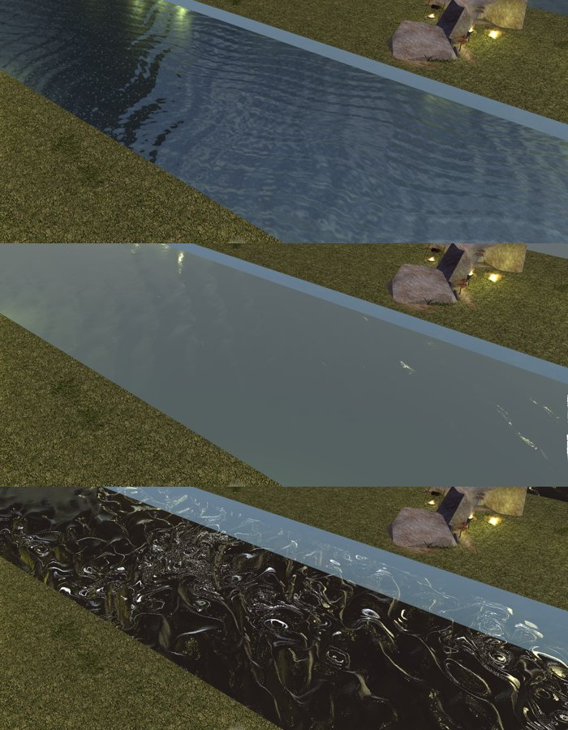

# A framebuffer for the game's water and particles: a proposal

Status: draft, for the owner's decision (2026-10-27).[^request] A spike
is on the branch `framebuffer-assessment` (commit `039c999b`, labeled an
experiment, off by default)[^spike]; nothing of it is on `develop`.

**The question.** The game's programs read a copy of the picture drawn
so far (`texFBColor`) and of its depth (`texFBDepth`). Moonglow binds
white for both, so the game's `fswater` draws water opaque and pale and
Moonglow keeps its own water shader; particles never fade where they
meet the ground. Should Moonglow make the copy?

**In short.** Yes, as a medium piece of work (M), in five steps, with
the third step a gate: draw `fswater` with the copy and compare it with
the client's pictures before making it the default. The copy itself
costs next to nothing on the development machine (0.0 to 0.2 ms of the
GPU at 3000×1250 with 4x MSAA, no measurable processor time);
`fswater` drawing with it costs 1.4 to 2.0 ms more than Moonglow's own
water where water fills the view (1.0 to 1.3 of that its screen-space
reads), within the 6.94 ms budget in the area measured. It buys the stock water and soft particles only: none
of The Domains of Dread's 37 programs reads the framebuffer.

## 1. What reads the framebuffer

From the install's shader sources:[^stock-shd]

| Program | What it reads | What for |
|---|---|---|
| `fswater` (through `inc_water` → `inc_framebuffer`) | `texFBDepth` at its own pixel, and along two marched rays; `texFBColor` where they end | the depth of water under the surface, the refraction, the reflection |
| `vswater` | nothing of the framebuffer | the wind (`areaGlobalWind`) and the clock to `fswater` |
| `fsparticle` | `texFBDepth` at its own pixel, only where `particleSoftness` is above 0 | soft particles |
| `fsfbbloom`, `fsfbssao`, `inc_postpr*` | both | post-processing, which Moonglow does not draw |

No other stock program includes `inc_framebuffer`.

**`fswater`, step by step** (at `SHADER_QUALITY_MODE` 2, Moonglow's
preamble):

- `vScreenCoords = gl_FragCoord.xy · (1/width, 1/height)`;
  `fScreenFBDepth = GetDepth(vScreenCoords)`, where `GetDepth` turns the
  stored depth `d` back into a distance: `near / (1 − d·(1 − near/far))`.
  The water's depth below its surface is that distance minus the
  surface's own. It sets the main wave's height
  (`fMainWaveAmplitude *= min(1, NdotV · depth)`: shallow water is calm).
- **Refraction.** The view ray bent by the wave normal (index 1/1.333,
  less the bend of the flat surface) is marched through the depth copy,
  5 steps over at most 4 m (`GetRayIntersectCoords`); `texFBColor` is
  read where it meets the scene, or at the pixel itself where it doesn't.
  How much of it shows is `exp2(−depth · 0.25 · a / (1 − a))`, `a` the
  water texture's alpha at its smallest mip: an opaque water texture
  shows nothing under it, with the copy or without.
- **Reflection** is two things. The **environment map**, through
  `ENVIRONMENT_MAP 1` and the lighting (the tileset's 2D map, which M5
  found bound and Moonglow binds already[^m5]). And a **screen-space
  reflection**: the reflected ray marched 10 steps through the depth
  copy (`GetReflectionCoords`), `texFBColor` read where it hits,
  rejected where the surface hit faces away (`GetNormalVector`, four
  more depth reads), fogged, and added by the Fresnel term (specularity
  0.02). Where the ray finds nothing the water shows its own lit colour.
  So the "water reflections" asked about are partly there today (the
  map) and partly the framebuffer's (trees, walls and fires mirrored on
  the water, from what is on the screen).
- Without the copy (white: the far plane everywhere) the water is
  infinitely deep: full waves, no refraction, no screen-space
  reflection: the opaque pale water M5 measured.[^m5]

**`fsparticle`**: `a *= sqr(clamp((sceneDepth − particleDepth) ·
particleSoftness, 0, 1))`. The client has `particleSoftness` above 0 for
every blend (M5's marks[^notes-shaders]); its value was not read.

**The Domains of Dread.**[^tdod-shd] None of its 37 programs includes
`inc_framebuffer`, names `texFB*` or reads `gl_FragCoord`; their
samplers are `texUnit0`, 1, 2, 5 and 6. Two of its 18,155 materials say
`sample_framebuffer 2`: `dd_tap_fm01_0529` (`dd_tap_flow_fs`) and
`mtr_fm01_0475` (`shd_flowmap_fs`), the flow materials. Their programs
read no framebuffer; the flag asks the engine to draw them late, after
the shadows[^notes-models]. For TDoD the copy brings the stock water
(its `tdod_water` hak has ten water TXIs) and soft particles, nothing of
its own shaders.

## 2. Where the copy goes in Moonglow's frame

Today the frame is one render pass[^renderer]: the sky, Moonglow's solid
meshes, the game's solid draws as one block, then the see-through
meshes' two parts (`Blend`, `Fringe`), additive meshes, particles and
the lines. The area view draws into targets of its own (`Targets`, 4x
MSAA, `Rgba8Unorm`, `Depth32Float`) and shows the result as an egui
image: the copy belongs inside `Renderer::render`, not in egui's paint
callback.

The copy goes **after the solid meshes**: the pass ends where the game's
solid draws have gone in, the copy is made, and a second pass goes on
over the same targets (loaded, not cleared). Water through `fswater` is
drawn first in the second pass (it writes depth), then the rest. Water
must not be in the copy: `fswater` measures its depth against the
depth behind it.

What wgpu needs:

- **Colour**: the multisampled picture is resolved by the copy itself (a
  full-screen draw averaging the four samples, as the hardware resolve
  does) into a texture of the target's size and format. Gamma space, as
  the client's (`fswater` linearizes what it reads).
- **Depth**: WebGPU resolves no depth, and a depth format bound as a
  float texture is not something to lean on across backends. The same
  draw reads the depth's first sample (`texture_depth_multisampled_2d`)
  and writes it into an `R32Float` texture. `R32Float` is not filterable
  without an optional feature, so `texFBDepth` gets a `NonFiltering`
  sampler and an unfilterable binding (the spike keys this on the
  sampler's name, as `game::unit` keys every unit).
- **Values**: none to convert. The stored depth is OpenGL's (`link.rs`
  takes the position's z to `(z + w)/2` as it leaves[^renderer]), and
  `clipParams` (`near`, `far`, `1 − near/far`) is filled already, so
  `GetDepth` reads distances in metres as in the client.
- **Memory**: two textures of the view's size: 30 MB at 3000×1250, 40 MB
  at 3440×1440. The targets' multisampled colour and depth need
  `TEXTURE_BINDING` as well.
- **One copy serves both** water and particles: particles are drawn last,
  after it. What they won't see is what is drawn after the copy: a
  particle meeting water or a see-through leaf fades against what lies
  behind those, not against them. Whether the client copies again (after
  water, or for `sample_framebuffer 1` and 2) is not known.

## 3. The spike

On `framebuffer-assessment`, off by default[^spike]:

- `Renderer::framebuffer` cuts the pass after the solid meshes and makes
  the copy (`crates/mg-render/src/framebuffer.rs`, one full-screen draw
  writing both textures, rows written as OpenGL's).
- `texFBColor` and `texFBDepth` are bound to the copies (`Unit::FbColor`,
  `Unit::FbDepth`); shiny water through `fswater` is drawn after the copy.
- A fragment program that reads the framebuffer counts `gl_FragCoord.y`
  from the bottom (a text rewrite in `mg-shader`'s assembly: section 7).
- `frame_perf`: `FRAME_FB_COPY=0|1|2|3` times every `area_parts` view
  with and without the copy (0 the cut alone, 1 the colour, 2 both, 3
  both at the frame's end), `FRAME_FB_SHOTS=1` saves the frames.

It draws `fswater` with the copy, see-through to the tile's bed. It is a
measurement, not the implementation: the copy is made in every frame,
not only one with a reader; the rewrite is textual and applies whether
the copy is on or not; the copies live in the renderer, not with the
targets.

## 4. What it costs

Measured with `frame_perf`'s `area_parts`[^frame-perf] (release, the
development machine, 3000×1250, the GPU's time over its quickest tenth of the frames;
the machine was shared with other builds, so differences under 0.1 ms
are noise):

| View | Without | With the copy | |
|---|---|---|---|
| Water and fires (`water_area`), overview, 4x MSAA | 1.67 ms | 1.70 ms | Shaders off |
| …overview, 4x MSAA, Shaders on | 1.64 | 1.71 | |
| …overview, no MSAA, Shaders on | 1.47 | 1.50 | |
| …close, 4x MSAA, Shaders on | 3.07 | 3.16 | |
| TDoD's woods (`tdod_area`), overview, 4x MSAA | 11.21 | 11.37 | Shaders off |
| …overview, 4x MSAA, Shaders on | 10.26 | 10.23 | |
| …close, 4x MSAA | 3.39 | 3.43 | |

- **The cut alone** (`FRAME_FB_COPY=0`) costs nothing measurable, with
  4x MSAA or without (TDoD's woods: 11.02 against 10.78, 3.39 against
  3.40).
- **The processor**: the draws' encoding is unchanged (2.45 ms without,
  2.43 with, in the water area; 24–37 ms in TDoD's woods either way).
- **A trap, measured**: made after the frame's textures had been read,
  in TDoD's woods, the copies cost **4.1 ms** (2 for the colour, 2 for
  the depth; 1.0–1.2 ms at a quarter of the pixels; the same at the frame's
  end, so not what the copy does to the passes after it; the same with
  the driver's compression off). The test fills the card's video memory
  (16.8 of 17.1 GB at its peak, 2 GB spilled to the system's): textures
  made late were placed in system memory and written over PCIe. Made
  before the frame's textures, the same copies cost 0.0–0.2 ms. The
  implementation makes them with the targets.
- **`fswater` reading the copy** costs what the client's water costs:
  its marches now run against real depth. In the water area, Shaders on,
  the game's water: 1.76 → 3.07 ms (overview), 4.03 → 5.09 ms (close);
  against Moonglow's own water (1.64 and 3.07 ms) that is 1.4 and 2.0 ms
  more, within the 6.94 ms budget[^notes-frames] in this area.
- **Not measured**: TDoD's woods have no shiny water (its cost there is
  the copy's); a light-dense area with water filling a 3440×1440 view;
  Apple's tiled GPUs, where ending a pass stores the multisampled
  attachments (Moonglow stores them already) and the copy then reads
  them back.

## 5. What the pictures would gain

The client's pictures that `surfaces_in_the_client` compares against
are not on disk (the client runs write them to scratch folders that the
next run empties), so the spike's water could not be held to them.
What the spike shows, in its water area[^frame-perf]:

- **Moonglow's own water** (top): bright, blue, its own ripples.
- **`fswater` without the copy** (middle): opaque and pale, as M5
  measured (the lake 19.4 of 255 from the client, against Moonglow's
  12.6; TDoD's fountain 16.4 against 11.7[^m5]).
- **`fswater` with the copy** (bottom): see-through to the tile's bed
  (`ttr01_b20_01`'s dark plane under the water), the waves bending
  what lies under them, the sky mirrored along the far edge. Seen from
  above, a water band's mean colour goes from (86.6, 101.4, 111.9) with
  Moonglow's water and (74.8, 85.5, 87.8) with `fswater` without the copy
  to (57.0, 68.4, 70.8) with it: darker, as M5 found the client's water
  ("darker and see-through to what lies under it", the fountain's basin
  showing its floor).

Whether it is now *closer* to the client than Moonglow's 12.6 and 11.7
is the gate of step 3, and has to be measured: the bottom picture's
strong swirls may be the client's look or a mistake of the spike (the
`gl_FragCoord` convention, section 7, and `inc_framebuffer`'s fixed 45°
field of view where Moonglow's camera has 40°, which bends the
reflection's rejection test).

**Soft particles** were not drawn: `particleSoftness`'s value is not
known (only that the client sets it above 0). With it, a fire's or
smoke's quads stop showing the hard line where they cut the ground.

## 6. The alternatives

| | What | Size | What it gains |
|---|---|---|---|
| **A** | The copy, `fswater` and `fsparticle` reading it (this proposal) | M | the client's water (refraction, screen-space reflections, the waves and their calm in shallows) and soft particles, from the game's own programs: what the client does, by construction |
| **B** | A depth copy only; Moonglow's water blended by `fswater`'s `exp2` transparency, its waves ported | M–L | see-through water and soft edges in Moonglow's shader; no screen-space reflection; a second implementation of the client's water to keep matching |
| **C** | Port `GetWavesOffset` and `areaGlobalWind` into Moonglow's water (deferred.md's other option) | S–M | the client's wave pattern on Moonglow's water; nothing of the colour |

C does not reach the gap M5 measured: `fswater` without the copy has the
client's wave pattern and is *farther* from the client (19.4 against
12.6), so the difference is the colour, which is the refraction of what
lies under the water, which needs the depth and the colour behind it. B
needs the same copy (the depth) and the same cut of the pass, and then
reimplements what A gets from the game's own source, with no screen-space
reflection. A is the smaller road to the client's look.

## 7. Portability

- **Direct3D 12 and Metal** (CI: Microsoft's Basic Render Driver and
  Apple's paravirtual device): what the copy uses is core WebGPU: a
  multisampled colour and depth texture bound for reading
  (`texture_multisampled_2d`, `texture_depth_multisampled_2d`),
  `R32Float` as a render target, an unfilterable texture with a
  non-filtering sampler. No optional feature. The spike ran on Vulkan
  only; a temporary branch through CI settles the other two, as for the
  renderer before.
- **`gl_FragCoord.y`**: `fswater` mixes two kinds of screen coordinates:
  from `gl_FragCoord` (`vScreenCoords`; `fsparticle`'s too) and from the
  projection (`0.5·xy/z + 0.5` in the ray marches; `vScreenCoords·2 − 1`
  in `GetViewPositionFromDepth`). In OpenGL both count from the bottom,
  as the rows of the framebuffer's copy do. In wgpu `gl_FragCoord` and a
  texture's rows count from the top, on every backend. Copied as it is,
  the first kind finds its pixel and the second reads a mirrored one (the
  refraction and the reflection would bend the wrong way). The
  consistent answer is OpenGL's throughout: the copy written upside down
  and `gl_FragCoord.y` turned to `height − y` in the programs that read
  the framebuffer. The spike does the second as a text rewrite before
  glslang (glslang refuses a macro named `gl_*`); the implementation
  should do it in IR in `link.rs`, beside `gl_depth_to_wgpu`, and hold it
  with a render test: an authored program reading `texFBColor` at its
  own `gl_FragCoord` and at its projected position must read the same
  pixel. deferred.md's note that no drawn program reads `gl_FragCoord`
  stops being true with this.
- **naga**: the samplers come out of the sampler split as a
  `texture_2d<f32>` and a sampler like any other; nothing special was
  needed beyond the binding types (the spike's pipelines validated).

## 8. Recommendation

**Do A, size M**, in five steps; the copy is cheap, made only in a
frame with a reader, and the game's programs then draw water as the
client does.

1. **The copy** (S). The targets own their copies (`Targets`, made
   with them: the thumbnails and the area view share one renderer at
   different sizes), with `TEXTURE_BINDING` on their multisampled colour
   and depth. The pass is cut after the solid meshes only when a draw of
   the frame reads the framebuffer (shiny water through `fswater`, or
   particles with a softness). Test: a render test that the copies hold
   the picture and its depth, rows OpenGL's.
2. **The game's programs read it** (S). `texFBColor`/`texFBDepth` bound
   to the copies (unfilterable depth, nearest sampler); put them in the
   draws' group (group 2, made per pipeline) so that a resize remakes a
   group per pipeline, not one per material. `gl_FragCoord.y` in
   OpenGL's sense in IR for the programs that read them, with the render
   test of section 7.
3. **Water through `fswater`, the gate** (S, and a client run). Water
   drawn after the copy; then `surfaces_in_the_client` (the far water)
   and the fountain test, against Moonglow's water's 12.6 and 11.7. If
   it is closer, `GAME_WATER` becomes true (Moonglow's water stays for
   Shaders off); if not, stop here and say why in the deferred list.
   `frame_perf` on the water area and TDoD's woods.
4. **Soft particles** (S, and a client run). Read `particleSoftness`'s
   value in the client (a marked `fsparticle` run encoding the float, as
   M5 encoded the flags), set it, and look at a fire on the ground.
5. **Direct3D 12 and Metal** (S): the renderer's tests through CI on a
   temporary branch.

Not in it: the `sample_framebuffer` materials' late drawing (TDoD's two
flow materials read nothing of it), post-processing, a second copy after
the water.

**A side finding.** `frame_perf`'s TDoD area fills the development
machine's 16 GB card (16.8 of 17.1 GB used, 2 GB spilled to system
memory) while it times its views; what is made last lands in system
memory. Whether the area view does the same with TDoD's real areas was
not looked at.

[^request]: The request (2026-10-27).
[^stock-shd]: The install's shader sources.
[^tdod-shd]: TDoD's haks, its programs and materials.
[^renderer]: Moonglow's renderer, develop 48f54c6b.
[^spike]: The branch `framebuffer-assessment`, commit `039c999b`.
[^frame-perf]: `frame_perf`, `game_shaders_frames_at_144`, run 2026-10-27.
[^notes-frames]: Frames at 144 a second.
[^m5]: The shaders proposal, M5.
[^notes-shaders]: The shader notes, J and the particles.
[^notes-models]: The model notes, E.8 and E.10.
